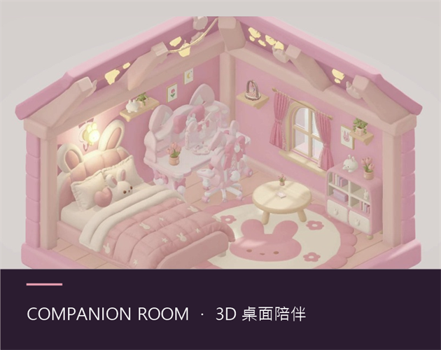
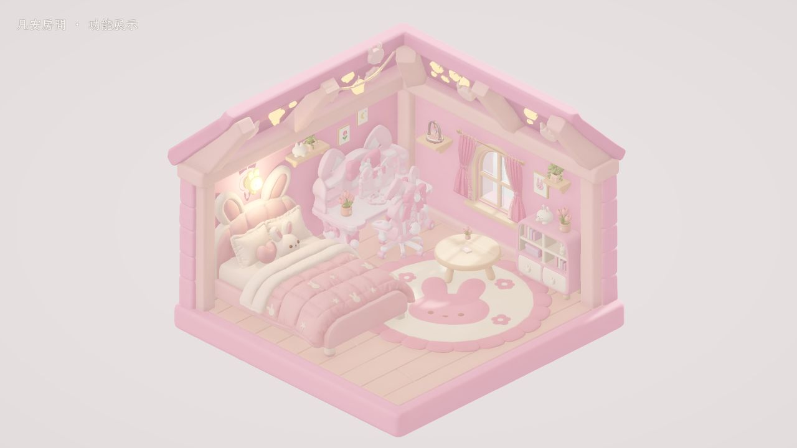
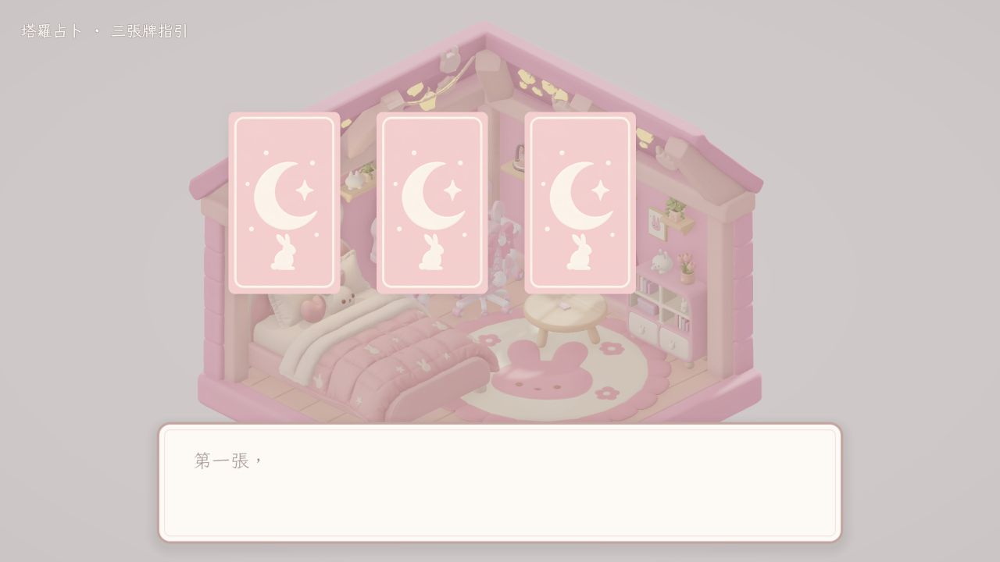
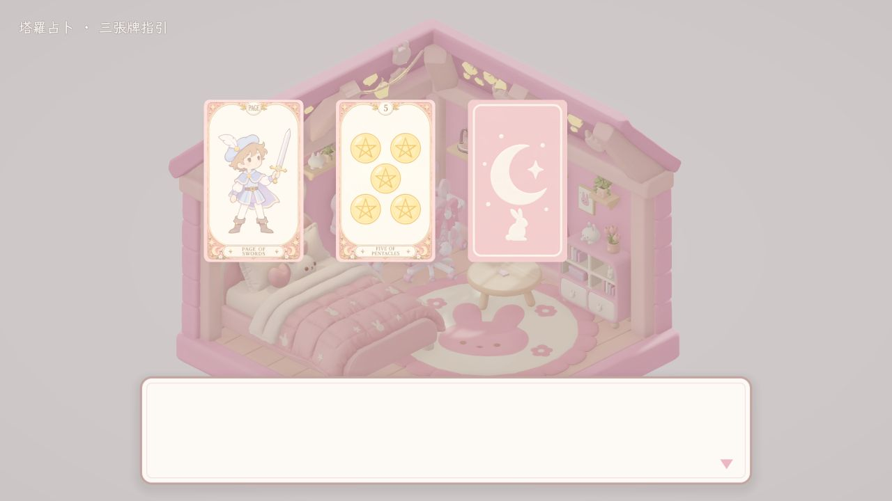
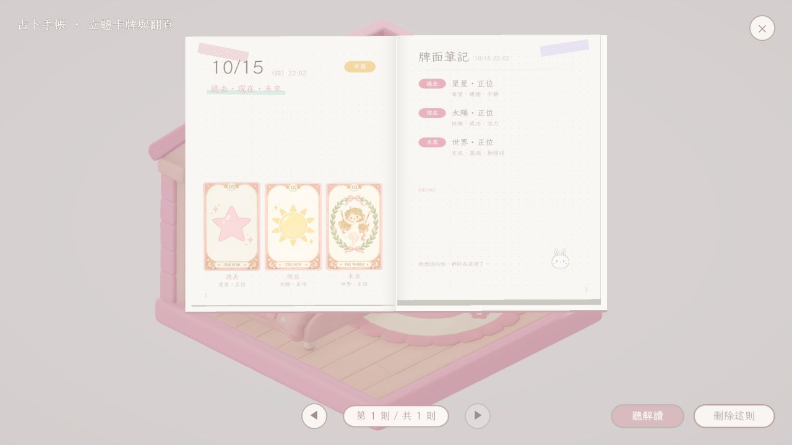
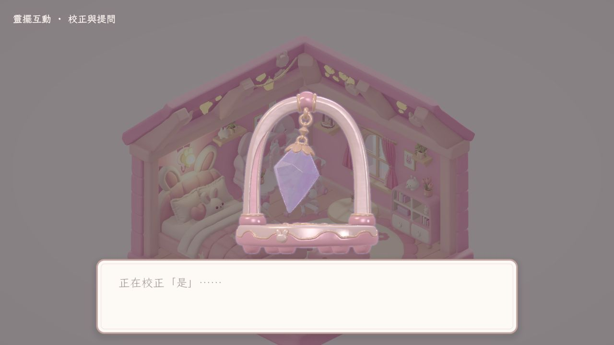
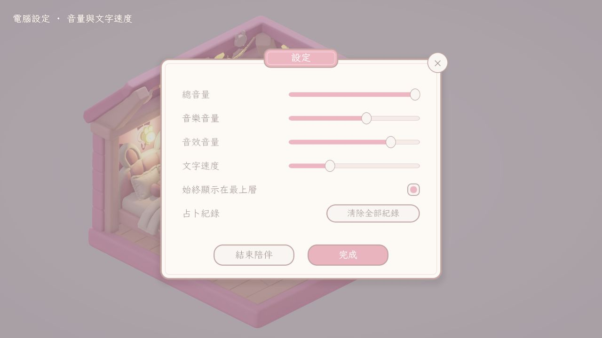

# Companion Room · 3D 桌面陪伴小屋



一個常駐在 Windows 桌面上的 3D 小房間：粉色兔兔房間像桌寵一樣浮在桌面上。點房間裡的家具就能互動：抽塔羅牌、用靈擺問是非題、切換早晨／夕陽／夜晚，每次占卜都會記進一本能翻頁的立體手帳。

*A 3D desktop-companion room for Windows, built with Unity 6 (URP). A transparent, click-through window turns a cozy pastel room into a desktop pet. Click the furniture to draw tarot cards, ask the pendulum yes/no questions, change the time of day, and browse every reading in a pop-up journal with real page-turn animation.*

🎬 **Trailer (60s)：** [Docs/Media/trailer_60s.mp4](Docs/Media/trailer_60s.mp4)

| 房間 | 塔羅發牌 | 翻牌解讀 |
|---|---|---|
|  |  |  |
| **占卜手帳** | **靈擺** | **設定（電腦）** |
|  |  |  |

---

## 功能

- **桌寵視窗**：透明、無邊框的全螢幕視窗，空白處點擊會穿透到後面的程式；拖曳牆面移動房間、拖曳角落縮放，位置與大小會記住，可設定永遠置頂。
- **家具互動**：滑鼠移到家具上出現金色外框，點擊後鏡頭平滑拉近並開啟對應功能；家具依 `assetId` 自動綁定互動元件，換模型、搬位置都不必重新設定。
- **塔羅占卜**：78 張自製粉彩牌面，單張／三張牌陣，洗牌、發牌、逐張翻牌，RPG 風格對話框逐張解讀，自動存檔。
- **立體占卜手帳**：書本完全由程式建模（封面、頁塊、書脊、彎曲翻頁的紙頁），抽到的牌會從頁面立起來；用獨立鏡頭圖層繪製，飛出書櫃時不會被家具遮住。
- **靈擺**：先校正「是／否」的擺動方向再提問，寶石、金屬使用自訂 shader。
- **光線與時段**：早晨／夕陽／夜晚三種氛圍平滑轉換（陽光、補光、環境色、窗外天空、後處理色調），可依現實時間自動切換；壁燈開關。
- **介面**：程式產生的 UI（UIFactory），所有圖片欄位留空時會自動畫出占位圖，可逐張替換成美術圖。
- **自動化測試**：
  - 執行檔加上 `-roomSelfTest <資料夾>` 會自動點過每個物品、逐步截圖並輸出 `report.txt`。
  - 編輯器選單內建 Play 模式檢查（手帳、電腦、靈擺），自動截圖產生報告。

## 技術重點

| 項目 | 內容 |
|---|---|
| 引擎 | Unity 6000.5（Unity 6）、Universal Render Pipeline |
| 語言 | C#（約 70 個檔案、12,000 行）、HLSL、Python |
| Shader | 懸停外框、手帳紙張、靈擺寶石／金屬／合成、柔光、窗外天空（共 8 個） |
| 桌寵視窗 | Win32 API 透明合成；建置時自動切換 D3D11 bitblt swapchain 與 URP 後處理 alpha 輸出，建置後還原編輯器設定（`DesktopPetBuildSettings.cs`） |
| 內容資料 | 對話文字、牌義以 JSON 管理（`Resources/CompanionRoom/`），可不改程式直接擴充 |
| 美術管線 | Python + Blender 腳本批次產生塔羅牌面、整理模型、匯出到 Unity（`Tools/`）；人物為 Procreate 手繪 |

### 程式架構

```
Assets/CompanionRoom/Scripts/
├─ Runtime/
│  ├─ Core/          CompanionRoomApp（互動流程總管）、桌寵視窗、設定、音效、自我測試
│  ├─ Character/     房間鏡頭（滑鼠視差、點擊拉近）
│  ├─ Interaction/   滑鼠懸停外框、點擊、依 assetId 自動綁定家具互動
│  ├─ Items/         電腦、書櫃、塔羅、靈擺、壁燈、窗戶、相框…
│  ├─ Tarot/         牌組、牌面視覺、占卜紀錄存取
│  ├─ Journal/       立體手帳模型、翻頁、頁面排版
│  ├─ Lighting/      時段光線
│  └─ UI/            對話框、塔羅桌、各面板、程式化 UI 元件
└─ Editor/           場景產生器、建置設定、模型匯入工作區、Play 模式自動檢查
```

`CompanionRoomApp` 一次只執行一個互動：鏡頭拉近物品 → 物品的協程（對話、視窗）執行 → 回到原狀；`Esc` 隨時中斷。

## 執行方式

**直接遊玩**：到 [itch.io](https://proximachiang.itch.io/proximachiangitchioroom) 下載 Windows 版壓縮檔，解壓後執行 `.exe`。

**開啟專案**：

1. 安裝 Unity **6000.5.0f1**（或相容的 Unity 6 版本）。
2. 用 Unity Hub 開啟本資料夾。
3. 開啟場景 `Assets/CompanionRoom/Scenes/CompanionRoom.unity`，按 Play。

## 文件

`Docs/` 內有各系統的說明（中文）：互動與手帳、房間校正與燈光、視角與視窗操作、靈擺、模型擺放規格、塔羅美術。

## 製作工具與素材

- Unity、C#、HLSL、Blender、Python
- 3D 模型：以 Tripo3D 生成後，用 Blender／Python 腳本整理並匯入
- 字型：霞鶩文楷 TC（SIL Open Font License）
- 預告片配樂：程式生成的原創曲，未使用第三方音樂
